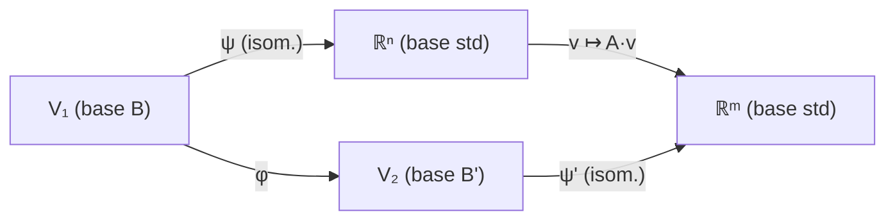
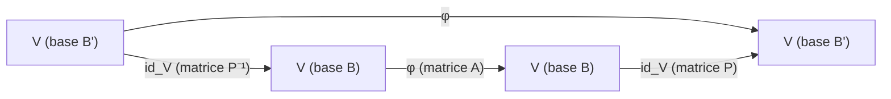

---

title: Applicazioni Lineari, Matrici e Cambiamento di Base

tags:

- algebra-lineare

- matematica

- applicazioni-lineari

- matrici

- dispense

---
 
  

# Applicazioni Lineari e Matrici

  

> [!abstract] Panoramica del Modulo

> Queste dispense coprono integralmente gli argomenti trattati a lezione:

> 1. **Applicazioni lineari**: definizione, esempi e controesempi.

> 2. **Nucleo e Immagine**: sottospazi fondamentali e **Teorema del Rango** (nullità più rango).

> 3. **Rappresentazione matriciale**: matrice associata rispetto a basi qualsiasi e calcolo di $\ker(\varphi)$ e $\operatorname{Im}(\varphi)$ tramite riduzione di Gauss.

> 4. **Isomorfismi e Composizione**: isomorfismo delle coordinate, prodotto riga per colonna e matrice inversa.

> 5. **Geometria piana**: riflessioni, proiezioni e rotazioni nel piano $\mathbb{R}^2$.

> 6. **Cambiamento di base**: formula di similitudine $P A P^{-1}$ e applicazioni geometriche.

  

---

  

## 1. Applicazioni Lineari

  

> [!abstract] Definizione (Applicazione Lineare)

> Siano $V_1$ e $V_2$ due spazi vettoriali su $\mathbb{R}$. Un'applicazione (o *mappa*) $\varphi: V_1 \to V_2$ si dice **lineare** se soddisfa le seguenti due proprietà:

> - **Additività**: $\varphi(v_1 + v_2) = \varphi(v_1) + \varphi(v_2) \quad \forall v_1, v_2 \in V_1$

> - **Omogeneità**: $\varphi(\lambda v) = \lambda \varphi(v) \quad \forall \lambda \in \mathbb{R}, \; \forall v \in V_1$

  

> [!tip] Osservazione

> Le due condizioni possono essere sintetizzate in un'unica condizione di linearità:
> $$\varphi(\lambda_1 v_1 + \lambda_2 v_2) = \lambda_1 \varphi(v_1) + \lambda_2 \varphi(v_2) \quad \forall \lambda_1, \lambda_2 \in \mathbb{R}, \; \forall v_1, v_2 \in V_1$$
> Inoltre, per ogni applicazione lineare vale sempre $\varphi(0_{V_1}) = 0_{V_2}$ (basta porre $\lambda = 0$).

  

### Esempi e Controesempi

  

> [!example] Esempio 1: Funzionali lineari su $\mathbb{R}^n$

> Siano $V_1 = \mathbb{R}^n$, $V_2 = \mathbb{R}$ e fissati $\lambda_1, \dots, \lambda_n \in \mathbb{R}$, l'applicazione:
> $$\varphi\begin{bmatrix} a_1 \\ \vdots \\ a_n \end{bmatrix} = \lambda_1 a_1 + \dots + \lambda_n a_n$$
> **è lineare**. Infatti:
> - $\varphi(a + b) = \lambda_1(a_1 + b_1) + \dots + \lambda_n(a_n + b_n) = (\lambda_1 a_1 + \dots + \lambda_n a_n) + (\lambda_1 b_1 + \dots + \lambda_n b_n) = \varphi(a) + \varphi(b)$.
> - $\varphi(\lambda a) = \lambda_1(\lambda a_1) + \dots + \lambda_n(\lambda a_n) = \lambda(\lambda_1 a_1 + \dots + \lambda_n a_n) = \lambda \varphi(a)$.
>
> **Controesempi (NON lineari):**
> 1. $\tilde{\varphi}\begin{bmatrix} a_1 \\ \vdots \\ a_n \end{bmatrix} = \lambda_1 a_1 + \dots + \lambda_n a_n + c$ con $c \neq 0$ (non è lineare perché $\tilde{\varphi}(0) = c \neq 0$).
> 2. $\psi\begin{bmatrix} a_1 \\ \vdots \\ a_n \end{bmatrix} = \lambda_1 a_1^2 + \dots + \lambda_n a_n^2$ (non è lineare per la presenza dei quadrati). 

> [!example] Esempi 2 – 5: Altre applicazioni lineari fondamentali

> - **Esempio 2 (Mappe tra spazi euclidei):** Dati $\lambda_1, \dots, \lambda_n$ e $\mu_1, \dots, \mu_n \in \mathbb{R}$ fissi, l'applicazione $\psi: \mathbb{R}^n \to \mathbb{R}^2$ definita da:
> $$\psi\begin{bmatrix} a_1 \\ \vdots \\ a_n \end{bmatrix} = \begin{bmatrix} \lambda_1 a_1 + \dots + \lambda_n a_n \\ \mu_1 a_1 + \dots + \mu_n a_n \end{bmatrix}$$
> è lineare. Questo si generalizza naturalmente a mappe $\mathbb{R}^n \to \mathbb{R}^m$ con $m$ righe.
> - **Esempio 3 (Proiezione / Troncamento):** La mappa $\varphi: \mathbb{R}^n \to \mathbb{R}^{n-1}$ definita da:
> $$\varphi\begin{bmatrix} a_1 \\ \vdots \\ a_{n-1} \\ a_n \end{bmatrix} = \begin{bmatrix} a_1 \\ \vdots \\ a_{n-1} \end{bmatrix}$$
> è lineare (analogamente per $\mathbb{R}^n \to \mathbb{R}^{n-2}$, $\mathbb{R}^{n-3}$, ecc.).
> - **Esempio 4 (Derivazione di polinomi):** Siano $V_1 = \mathbb{R}[x]_{\le d}$ e $V_2 = \mathbb{R}[x]_{\le d-1}$. L'operatore derivata $\varphi(f) := f'$ è lineare poiché $(f_1 + f_2)' = f_1' + f_2'$ e $(\lambda f)' = \lambda f'$. Esplicitamente:
> $$(a_d x^d + \dots + a_1 x + a_0)' = d a_d x^{d-1} + (d-1)a_{d-1} x^{d-2} + \dots + a_1$$
> - **Esempio 5 (Integrazione definita):** Sia $V_1 = \{f: [0,1] \to \mathbb{R} \mid f \text{ continua}\}$ e $V_2 = \mathbb{R}$. L'operatore $\varphi(f) := \int_0^1 f(x)\,dx$ è lineare perché $\int_0^1 (f_1 + f_2) = \int_0^1 f_1 + \int_0^1 f_2$ e $\int_0^1 (\lambda f) = \lambda \int_0^1 f$.
---
## 2. Nucleo, Immagine e Teorema del Rango

  

> [!abstract] Definizione (Nucleo e Immagine)

> Sia $\varphi: V_1 \to V_2$ un'applicazione lineare. Si definiscono due sottoinsiemi fondamentali:
> 1. **Nucleo** (*Kernel*):
> $$\ker(\varphi) := \{v \in V_1 : \varphi(v) = 0_{V_2}\} \subseteq V_1$$
> 2. **Immagine**:
> $$\operatorname{Im}(\varphi) := \{w \in V_2 : \exists v \in V_1 \text{ tale che } w = \varphi(v)\} \subseteq V_2$$

> [!info] Proposizione

> Se $\varphi: V_1 \to V_2$ è lineare, allora $\ker(\varphi) \subseteq V_1$ e $\operatorname{Im}(\varphi) \subseteq V_2$ sono **sottospazi vettoriali**.

> [!note]- Dimostrazione

> - **Per $\ker(\varphi)$**:
> - Se $\varphi(v_1) = 0$ e $\varphi(v_2) = 0$, allora $\varphi(v_1 + v_2) = \varphi(v_1) + \varphi(v_2) = 0 + 0 = 0 \implies v_1 + v_2 \in \ker(\varphi)$.
> - Se $\varphi(v) = 0$ e $\lambda \in \mathbb{R}$, allora $\varphi(\lambda v) = \lambda \varphi(v) = \lambda \cdot 0 = 0 \implies \lambda v \in \ker(\varphi)$.
> - **Per $\operatorname{Im}(\varphi)$**:
> - Se $w_1 = \varphi(v_1)$ e $w_2 = \varphi(v_2)$, allora $w_1 + w_2 = \varphi(v_1) + \varphi(v_2) = \varphi(v_1 + v_2) \in \operatorname{Im}(\varphi)$.
> - Se $w = \varphi(v)$ e $\lambda \in \mathbb{R}$, allora $\lambda w = \lambda \varphi(v) = \varphi(\lambda v) \in \operatorname{Im}(\varphi)$.

> [!important] Teorema della Dimensione (Nullità più Rango)

> Sia $V_1$ uno spazio vettoriale di dimensione finita ($\dim V_1 < \infty$) e sia $\varphi: V_1 \to V_2$ un'applicazione lineare. Allora:
> $$\dim \ker(\varphi) + \dim \operatorname{Im}(\varphi) = \dim V_1$$

  

> [!note]- Dimostrazione

> Siano:
> - $v_1, \dots, v_r$ una base di $\ker(\varphi)$ (quindi $\dim \ker(\varphi) = r$).
> - $w_1, \dots, w_s$ una base di $\operatorname{Im}(\varphi)$ (quindi $\dim \operatorname{Im}(\varphi) = s$).
> Poiché $w_i \in \operatorname{Im}(\varphi)$, esistono dei vettori $\bar{v}_1, \dots, \bar{v}_s \in V_1$ tali che $\varphi(\bar{v}_i) = w_i$ per ogni $i = 1, \dots, s$.
> Dimostriamo che $\{v_1, \dots, v_r, \bar{v}_1, \dots, \bar{v}_s\}$ è una **base di $V_1$** (da cui $\dim V_1 = r + s$):
>
> 1. **Indipendenza lineare:** Supponiamo che:
> $$\lambda_1 v_1 + \dots + \lambda_r v_r + \lambda_{r+1} \bar{v}_1 + \dots + \lambda_{r+s} \bar{v}_s = 0$$
> Applichiamo $\varphi$ a entrambi i membri. Poiché $\varphi(v_i) = 0$ per ogni $i=1,\dots,r$, otteniamo:
> $$\lambda_{r+1} \varphi(\bar{v}_1) + \dots + \lambda_{r+s} \varphi(\bar{v}_s) = 0 \implies \lambda_{r+1} w_1 + \dots + \lambda_{r+s} w_s = 0$$
> Essendo $w_1, \dots, w_s$ linearmente indipendenti (base di $\operatorname{Im}(\varphi)$), segue $\lambda_{r+1} = \dots = \lambda_{r+s} = 0$.
> Sostituendo nella combinazione iniziale resta $\lambda_1 v_1 + \dots + \lambda_r v_r = 0$; poiché $v_1, \dots, v_r$ sono una base di $\ker(\varphi)$, segue anche $\lambda_1 = \dots = \lambda_r = 0$.
>
> 2. **Sistema di generatori:** Sia $v \in V_1$ qualsiasi. Allora $\varphi(v) \in \operatorname{Im}(\varphi)$, quindi esistono $\bar{\lambda}_1, \dots, \bar{\lambda}_s \in \mathbb{R}$ tali che:
> $$\varphi(v) = \bar{\lambda}_1 w_1 + \dots + \bar{\lambda}_s w_s$$
> Consideriamo il vettore $u := v - \bar{\lambda}_1 \bar{v}_1 - \dots - \bar{\lambda}_s \bar{v}_s$. Calcolando $\varphi(u)$:
> $$\varphi(u) = \varphi(v) - \bar{\lambda}_1 \varphi(\bar{v}_1) - \dots - \bar{\lambda}_s \varphi(\bar{v}_s) = \varphi(v) - (\bar{\lambda}_1 w_1 + \dots + \bar{\lambda}_s w_s) = 0$$
> Dunque $u \in \ker(\varphi)$, per cui si scrive come combinazione lineare della base del nucleo:
> $$v - \bar{\lambda}_1 \bar{v}_1 - \dots - \bar{\lambda}_s \bar{v}_s = \lambda_1 v_1 + \dots + \lambda_r v_r$$
> Portando i termini a destra otteniamo $v = \lambda_1 v_1 + \dots + \lambda_r v_r + \bar{\lambda}_1 \bar{v}_1 + \dots + \bar{\lambda}_s \bar{v}_s$, ovvero $\operatorname{Span}(v_1, \dots, v_r, \bar{v}_1, \dots, \bar{v}_s) = V_1$. $\blacksquare$

### Applicazioni del Teorema della Dimensione

> [!example] Esempio 1: Soluzioni di un'equazione lineare omogenea

> Sia $V = \left\{ \begin{bmatrix} x_1 \\ \vdots \\ x_n \end{bmatrix} \in \mathbb{R}^n : a_1 x_1 + \dots + a_n x_n = 0 \right\}$ con $a_1, \dots, a_n \in \mathbb{R}$ non tutti nulli.
> Consideriamo $\varphi: \mathbb{R}^n \to \mathbb{R}$ definita da $\varphi(x) = a_1 x_1 + \dots + a_n x_n$. Chiaramente $V = \ker(\varphi)$.
> Poiché i coefficienti $a_i$ non sono tutti nulli, $\operatorname{Im}(\varphi) \neq \{0\}$. Gli unici sottospazi di $\mathbb{R}$ sono $\{0\}$ e $\mathbb{R}$, quindi $\operatorname{Im}(\varphi) = \mathbb{R}$ e $\dim \operatorname{Im}(\varphi) = 1$.
> Dal teorema della dimensione:
> $$\dim V = \dim \ker(\varphi) = n - 1$$
  

> [!example] Esempio 2: Suriettività della derivata sui polinomi

> Sia $\varphi: \mathbb{R}[x]_{\le d} \to \mathbb{R}[x]_{\le d-1}$ data da $\varphi(f) = f'$.
> - Sappiamo che $\dim \mathbb{R}[x]_{\le d} = d + 1$ (base $\{1, x, \dots, x^d\}$).
> - $\ker(\varphi) = \{f \in \mathbb{R}[x]_{\le d} : f' = 0\} = \{\text{polinomi costanti}\}$, per cui $\dim \ker(\varphi) = 1$.
> - Pertanto $\dim \operatorname{Im}(\varphi) = (d + 1) - 1 = d = \dim \mathbb{R}[x]_{\le d-1}$, il che implica $\operatorname{Im}(\varphi) = \mathbb{R}[x]_{\le d-1}$ (ogni polinomio di grado $\le d-1$ ammette primitiva di grado $\le d$).

> [!example] Esempio 3: Determinazione univoca su una base

> Se $\varphi: V_1 \to V_2$ è lineare e $\{e_1, \dots, e_n\}$ è una base di $V_1$, allora $\varphi$ è **completamente determinata** dai valori $\varphi(e_1), \dots, \varphi(e_n)$:
> $$v = a_1 e_1 + \dots + a_n e_n \implies \varphi(v) = a_1 \varphi(e_1) + \dots + a_n \varphi(e_n)$$
> Viceversa, scelti vettori $w_1, \dots, w_n \in V_2$ arbitrari, esiste un'unica applicazione lineare tale che $\varphi(e_i) = w_i$.
>
> **Confronto in $\mathbb{R}^2$:** Sia $e_1 = \begin{bmatrix} 0 \\ 1 \end{bmatrix}$, $e_2 = \begin{bmatrix} 1 \\ 0 \end{bmatrix}$.
> 1. Se $\varphi(e_1) = 0$ e $\varphi(e_2) = e_2$, allora $\varphi\begin{bmatrix} a_1 \\ a_2 \end{bmatrix} = \begin{bmatrix} a_1 \\ 0 \end{bmatrix}$. Qui $\ker(\varphi) = \operatorname{Span}(e_1)$ e $\operatorname{Im}(\varphi) = \operatorname{Span}(e_2)$, dunque $\ker(\varphi) \cap \operatorname{Im}(\varphi) = \{0\}$ e $\ker(\varphi) + \operatorname{Im}(\varphi) = \mathbb{R}^2$.
> 2. Se $\psi(e_1) = 0$ e $\psi(e_2) = e_1$, allora $\psi\begin{bmatrix} a_1 \\ a_2 \end{bmatrix} = \begin{bmatrix} 0 \\ a_1 \end{bmatrix}$. In questo caso $\ker(\psi) = \operatorname{Im}(\psi) = \operatorname{Span}(e_1)$!
>
> In entrambi i casi $\dim \ker + \dim \operatorname{Im} = 1 + 1 = 2 = \dim \mathbb{R}^2$.

> [!example] Esempio 4: Matrici $3 \times 3$ a somma di riga nulla

> Calcolare la dimensione di:

> $$U = \left\{ \begin{bmatrix} a_{11} & a_{12} & a_{13} \\ a_{21} & a_{22} & a_{23} \\ a_{31} & a_{32} & a_{33} \end{bmatrix} \in M_{3 \times 3}(\mathbb{R}) : \begin{aligned} a_{11} + a_{12} + a_{13} &= 0 \\ a_{21} + a_{22} + a_{23} &= 0 \\ a_{31} + a_{32} + a_{33} &= 0 \end{aligned} \right\}$$
> Definiamo $\varphi: M_{3 \times 3}(\mathbb{R}) \to \mathbb{R}^3$ come:
> $$\varphi\begin{bmatrix} a_{11} & a_{12} & a_{13} \\ a_{21} & a_{22} & a_{23} \\ a_{31} & a_{32} & a_{33} \end{bmatrix} = \begin{bmatrix} a_{11} + a_{12} + a_{13} \\ a_{21} + a_{22} + a_{23} \\ a_{31} + a_{32} + a_{33} \end{bmatrix}$$
> Chiaramente $\varphi$ è lineare e $\ker(\varphi) = U$. Inoltre $\varphi$ è suriettiva ($\operatorname{Im}(\varphi) = \mathbb{R}^3$), poiché per ogni $\begin{bmatrix} a \\ b \\ c \end{bmatrix} \in \mathbb{R}^3$ si ha $\varphi\begin{bmatrix} 0 & 0 & a \\ 0 & 0 & b \\ 0 & 0 & c \end{bmatrix} = \begin{bmatrix} a \\ b \\ c \end{bmatrix}$.
> Quindi:
> $$\dim U = \dim M_{3 \times 3}(\mathbb{R}) - \dim \mathbb{R}^3 = 9 - 3 = 6$$
---
## 3. Matrice Associata a un'Applicazione Lineare
### Caso $\mathbb{R}^n \to \mathbb{R}^m$ rispetto alle Basi Standard

> [!abstract] Definizione (Prodotto Matrice-Vettore)

> Siano $A \in M_{m \times n}(\mathbb{R})$ e $v = \begin{bmatrix} b_1 \\ \vdots \\ b_n \end{bmatrix} \in \mathbb{R}^n$. Il prodotto $A v \in \mathbb{R}^m$ è definito da:
> $$A v = \begin{bmatrix} a_{11} & a_{12} & \dots & a_{1n} \\ a_{21} & a_{22} & \dots & a_{2n} \\ \vdots & \vdots & \ddots & \vdots \\ a_{m1} & a_{m2} & \dots & a_{mn} \end{bmatrix} \begin{bmatrix} b_1 \\ b_2 \\ \vdots \\ b_n \end{bmatrix} := \begin{bmatrix} a_{11} b_1 + a_{12} b_2 + \dots + a_{1n} b_n \\ a_{21} b_1 + a_{22} b_2 + \dots + a_{2n} b_n \\ \vdots \\ a_{m1} b_1 + a_{m2} b_2 + \dots + a_{mn} b_n \end{bmatrix}$$

  

Sia $\varphi: \mathbb{R}^n \to \mathbb{R}^m$ lineare e sia $\{e_1, \dots, e_n\}$ la base standard di $\mathbb{R}^n$. Scrivendo i vettori immagine come colonne:

$$\varphi(e_1) = \begin{bmatrix} a_{11} \\ a_{21} \\ \vdots \\ a_{m1} \end{bmatrix}, \quad \varphi(e_2) = \begin{bmatrix} a_{12} \\ a_{22} \\ \vdots \\ a_{m2} \end{bmatrix}, \quad \dots, \quad \varphi(e_n) = \begin{bmatrix} a_{1n} \\ a_{2n} \\ \vdots \\ a_{mn} \end{bmatrix}$$

costruiamo la matrice $A \in M_{m \times n}(\mathbb{R})$ affiancando tali colonne:

$$A = \begin{bmatrix} \vert & \vert & & \vert \\ \varphi(e_1) & \varphi(e_2) & \dots & \varphi(e_n) \\ \vert & \vert & & \vert \end{bmatrix}$$

> [!info] Proposizione

> Per ogni vettore $v = \begin{bmatrix} b_1 \\ \vdots \\ b_n \end{bmatrix} \in \mathbb{R}^n$, vale $\varphi(v) = A \cdot v$.

> [!note]- Dimostrazione
]]
> Scrivendo $v = b_1 e_1 + \dots + b_n e_n$, per linearità si ha:
> $$\varphi(v) = b_1 \varphi(e_1) + \dots + b_n \varphi(e_n) = b_1 \begin{bmatrix} a_{11} \\ \vdots \\ a_{m1} \end{bmatrix} + \dots + b_n \begin{bmatrix} a_{1n} \\ \vdots \\ a_{mn} \end{bmatrix} = A \cdot v \quad \blacksquare$$
### Generalizzazione a Spazi Vettoriali Qualunque

> [!abstract] Definizione (Matrice Associata rispetto a Basi B, B')

> Siano $V$ e $W$ spazi vettoriali con $\dim V = n$ e $\dim W = m$. Fissate una base $\mathcal{B} = \{e_1, \dots, e_n\}$ di $V$ e una base $\mathcal{B}' = \{e'_1, \dots, e'_m\}$ di $W$, esprimiamo ciascun $\varphi(e_j)$ nella base $\mathcal{B}'$:
> $$\begin{aligned} \varphi(e_1) &= a_{11} e'_1 + a_{21} e'_2 + \dots + a_{m1} e'_m \\ &\;\;\vdots \\ \varphi(e_n) &= a_{1n} e'_1 + a_{2n} e'_2 + \dots + a_{mn} e'_m \end{aligned}$$
> La **matrice di $\varphi$ rispetto alle basi $\mathcal{B}$ e $\mathcal{B}'$**, indicata con $[\varphi]_{\mathcal{B}}^{\mathcal{B}'}$, è la matrice $A \in M_{m \times n}(\mathbb{R})$ avente per $j$-esima colonna le **coordinate di $\varphi(e_j)$ rispetto a $\mathcal{B}'$**:
> $$A = [\varphi]_{\mathcal{B}}^{\mathcal{B}'} = \begin{bmatrix} a_{11} & a_{12} & \dots & a_{1n} \\ a_{21} & a_{22} & \dots & a_{2n} \\ \vdots & \vdots & \ddots & \vdots \\ a_{m1} & a_{m2} & \dots & a_{mn} \end{bmatrix}$$

> [!important] Teorema (Calcolo tramite Coordinate)

> Se $v = b_1 e_1 + \dots + b_n e_n \in V$, allora le coordinate di $\varphi(v)$ rispetto alla base $\mathcal{B}'$ sono date dal prodotto matriciale:
> $$[\varphi(v)]_{\mathcal{B}'} = A \begin{bmatrix} b_1 \\ \vdots \\ b_n \end{bmatrix} = [\varphi]_{\mathcal{B}}^{\mathcal{B}'} \cdot [v]_{\mathcal{B}}$$

> [!tip] Nota Terminologica

> Quando $V = W$, si sceglie spesso la medesima base in partenza e in arrivo ($\mathcal{B} = \mathcal{B}'$). In tal caso si parla semplicemente di **matrice di $\varphi$ rispetto a $\mathcal{B}$**, denotata con $[\varphi]_{\mathcal{B}} := [\varphi]_{\mathcal{B}}^{\mathcal{B}}$.

> [!example] Esempi di Matrici Associate al Variare delle Basi

> 1. **Applicazione $\varphi: \mathbb{R}^2 \to \mathbb{R}$**, $\varphi\begin{bmatrix} x \\ y \end{bmatrix} = x + 2y$:
> - Rispetto alle basi standard: $\varphi\begin{bmatrix} 1 \\ 0 \end{bmatrix} = 1$, $\varphi\begin{bmatrix} 0 \\ 1 \end{bmatrix} = 2 \implies A = \begin{bmatrix} 1 & 2 \end{bmatrix} \in M_{1 \times 2}(\mathbb{R})$.
> - Rispetto alla base $\mathcal{B} = \left\{ \begin{bmatrix} 1 \\ 0 \end{bmatrix}, \begin{bmatrix} 1 \\ 1 \end{bmatrix} \right\}$ di $\mathbb{R}^2$ e $\{1\}$ di $\mathbb{R}$: $\varphi\begin{bmatrix} 1 \\ 0 \end{bmatrix} = 1$, $\varphi\begin{bmatrix} 1 \\ 1 \end{bmatrix} = 3 \implies A = \begin{bmatrix} 1 & 3 \end{bmatrix}$.
>
> 2. **Endomorfismo $\varphi: \mathbb{R}^2 \to \mathbb{R}^2$**, $\varphi\begin{bmatrix} x \\ y \end{bmatrix} = \begin{bmatrix} x + 2y \\ x + 2y \end{bmatrix}$:
> - Rispetto alla base standard: $A = \begin{bmatrix} 1 & 2 \\ 1 & 2 \end{bmatrix}$.
> - Rispetto alla base $\mathcal{B}_1 = \left\{ \begin{bmatrix} 1 \\ 0 \end{bmatrix}, \begin{bmatrix} 1 \\ 1 \end{bmatrix} \right\}$:
> $$\varphi\begin{bmatrix} 1 \\ 0 \end{bmatrix} = \begin{bmatrix} 1 \\ 1 \end{bmatrix} = 0\begin{bmatrix} 1 \\ 0 \end{bmatrix} + 1\begin{bmatrix} 1 \\ 1 \end{bmatrix}, \quad \varphi\begin{bmatrix} 1 \\ 1 \end{bmatrix} = \begin{bmatrix} 3 \\ 3 \end{bmatrix} = 0\begin{bmatrix} 1 \\ 0 \end{bmatrix} + 3\begin{bmatrix} 1 \\ 1 \end{bmatrix} \implies A = \begin{bmatrix} 0 & 0 \\ 1 & 3 \end{bmatrix}$$
> - Rispetto alla base $\mathcal{B}_2 = \left\{ \begin{bmatrix} 1 \\ 1 \end{bmatrix}, \begin{bmatrix} 2 \\ -1 \end{bmatrix} \right\}$:
> $$\varphi\begin{bmatrix} 1 \\ 1 \end{bmatrix} = \begin{bmatrix} 3 \\ 3 \end{bmatrix} = 3\begin{bmatrix} 1 \\ 1 \end{bmatrix} + 0\begin{bmatrix} 2 \\ -1 \end{bmatrix}, \quad \varphi\begin{bmatrix} 2 \\ -1 \end{bmatrix} = \begin{bmatrix} 0 \\ 0 \end{bmatrix} = 0\begin{bmatrix} 1 \\ 1 \end{bmatrix} + 0\begin{bmatrix} 2 \\ -1 \end{bmatrix} \implies A = \begin{bmatrix} 3 & 0 \\ 0 & 0 \end{bmatrix}$$
> In coordinate rispetto a $\mathcal{B}_2$, la mappa diventa diagonalizzata e semplicissima: $\begin{bmatrix} x \\ y \end{bmatrix} \mapsto \begin{bmatrix} 3x \\ 0 \end{bmatrix}$ (*anticipazione degli autovettori*).
>
> 3. **Derivata sui polinomi**:
> - Come endomorfismo $\varphi: \mathbb{R}[x]_{\le 2} \to \mathbb{R}[x]_{\le 2}$ nella base standard $\{1, x, x^2\}$:
> $$\varphi(1) = 0, \quad \varphi(x) = 1, \quad \varphi(x^2) = 2x \implies A = \begin{bmatrix} 0 & 1 & 0 \\ 0 & 0 & 2 \\ 0 & 0 & 0 \end{bmatrix}$$
> - Come mappa $\varphi: \mathbb{R}[x]_{\le 2} \to \mathbb{R}[x]_{\le 1}$ con base $\{1, x, x^2\}$ in partenza e $\{2, x+1\}$ in arrivo
> $$\varphi(1) = 0, \quad \varphi(x) = 1 = \tfrac{1}{2}(2) + 0(x+1), \quad \varphi(x^2) = 2x = (-1)(2) + 2(x+1) \implies A = \begin{bmatrix} 0 & \frac{1}{2} & -1 \\ 0 & 0 & 2 \end{bmatrix}$$
>
> 4. **Identità e Omotetie** ($\dim V = n$):
> - Per $\mathrm{id}_V(v) = v$, rispetto a **qualsiasi** base $\mathcal{B}$, $[\mathrm{id}_V]_{\mathcal{B}} = I_n = \begin{bmatrix} 1 & & 0 \\ & \ddots & \\ 0 & & 1 \end{bmatrix}$ (matrice identità).
> - Per $\varphi_\lambda(v) = \lambda v$ ($\lambda \in \mathbb{R}$), rispetto a **qualsiasi** base $\mathcal{B}$, $[\varphi_\lambda]_{\mathcal{B}} = \lambda I_n = \begin{bmatrix} \lambda & & 0 \\ & \ddots & \\ 0 & & \lambda \end{bmatrix}$.
> - Più in generale, se esiste una base $\{e_1, \dots, e_n\}$ tale che $\varphi(e_i) = \lambda_i e_i$, la matrice è **diagonale**: $\operatorname{diag}(\lambda_1, \dots, \lambda_n)$.
---
## 4. Calcolo di Nucleo e Immagine tramite la Matrice A

Sia $\varphi: \mathbb{R}^n \to \mathbb{R}^m$ lineare di matrice $A$ rispetto alle basi standard:

1. **Trovare $\ker(\varphi)$**:

$$x \in \ker(\varphi) \iff A x = 0 \iff \begin{cases} a_{11} x_1 + \dots + a_{1n} x_n = 0 \\ \qquad \vdots \\ a_{m1} x_1 + \dots + a_{mn} x_n = 0 \end{cases}$$

Basta risolvere il **sistema lineare omogeneo** associato mediante l'algoritmo di eliminazione di Gauss.

2. **Trovare $\operatorname{Im}(\varphi)$**:

Poiché $\operatorname{Im}(\varphi) = \operatorname{Span}(\varphi(e_1), \dots, \varphi(e_n))$, l'immagine coincide con lo **span delle colonne di $A$** in $\mathbb{R}^m$.

  

> [!abstract] Definizione (Rango di una Matrice)

> Data una matrice $A \in M_{m \times n}(\mathbb{R})$, il **rango** di $A$ è la dimensione dello spazio generato dalle sue colonne:
> $$\operatorname{rg}(A) := \dim \operatorname{Span}\left( \begin{bmatrix} a_{11} \\ \vdots \\ a_{m1} \end{bmatrix}, \dots, \begin{bmatrix} a_{1n} \\ \vdots \\ a_{mn} \end{bmatrix} \right)$$
> Pertanto:
> $$\dim \operatorname{Im}(\varphi) = \operatorname{rg}(A)$$

> [!info] Proposizione (Calcolo del Rango con Gauss)

> Il rango $\operatorname{rg}(A)$ è uguale al **numero di pivot** della forma ridotta a scalini di $A$. Inoltre, le colonne della matrice originale $A$ corrispondenti alle posizioni dei pivot formano una **base di $\operatorname{Im}(\varphi)$**.

> [!example] Esercizio Svolto: Basi di $\ker(\varphi)$ e $\operatorname{Im}(\varphi)$

> Sia $\varphi: \mathbb{R}^4 \to \mathbb{R}^3$ rappresentata rispetto alle basi standard dalla matrice:
> $$A = \begin{bmatrix} 1 & 2 & -1 & -2 \\ 1 & 1 & 1 & 1 \\ 1 & 0 & 3 & 4 \end{bmatrix}$$
> **Passo 1: Riduzione a scalini (Gauss)**
> $$\begin{bmatrix} 1 & 2 & -1 & -2 \\ 1 & 1 & 1 & 1 \\ 1 & 0 & 3 & 4 \end{bmatrix} \xrightarrow{\substack{R_2 - R_1 \\ R_3 - R_1}} \begin{bmatrix} 1 & 2 & -1 & -2 \\ 0 & -1 & 2 & 3 \\ 0 & -2 & 4 & 6 \end{bmatrix} \xrightarrow{R_3 - 2R_2} \begin{bmatrix} \boxed{1} & 2 & -1 & -2 \\ 0 & \boxed{-1} & 2 & 3 \\ 0 & 0 & 0 & 0 \end{bmatrix}$$
> - Ci sono **2 pivot** (nelle colonne 1 e 2), quindi $\operatorname{rg}(A) = \dim \operatorname{Im}(\varphi) = 2$.
> - **Base di $\operatorname{Im}(\varphi)$**: prendiamo le prime due colonne della matrice **originale** $A$:
> $$\mathcal{B}_{\operatorname{Im}} = \left\{ \begin{bmatrix} 1 \\ 1 \\ 1 \end{bmatrix}, \begin{bmatrix} 2 \\ 1 \\ 0 \end{bmatrix} \right\} \subset \mathbb{R}^3$$
>
> **Passo 2: Risoluzione del sistema $Ax = 0$ per $\ker(\varphi)$**
> $$\begin{cases} x_1 + 2x_2 - x_3 - 2x_4 = 0 \\ -x_2 + 2x_3 + 3x_4 = 0 \end{cases} \implies \begin{cases} x_2 = 2x_3 + 3x_4 \\ x_1 = -2(2x_3 + 3x_4) + x_3 + 2x_4 = -3x_3 - 4x_4 \end{cases}$$
> La soluzione generale al variare di $x_3, x_4 \in \mathbb{R}$ è:
> $$\begin{bmatrix} x_1 \\ x_2 \\ x_3 \\ x_4 \end{bmatrix} = x_3 \begin{bmatrix} -3 \\ 2 \\ 1 \\ 0 \end{bmatrix} + x_4 \begin{bmatrix} -4 \\ 3 \\ 0 \\ 1 \end{bmatrix}$$
> - **Base di $\ker(\varphi)$**:
> $$\mathcal{B}_{\ker} = \left\{ \begin{bmatrix} -3 \\ 2 \\ 1 \\ 0 \end{bmatrix}, \begin{bmatrix} -4 \\ 3 \\ 0 \\ 1 \end{bmatrix} \right\} \subset \mathbb{R}^4$$
> - **Verifica**: $\dim \ker(\varphi) + \dim \operatorname{Im}(\varphi) = 2 + 2 = 4 = \dim \mathbb{R}^4$.
---
## 5. Isomorfismi e Isomorfismo delle Coordinate

> [!abstract] Definizione (Isomorfismo)

> Un'applicazione lineare $\varphi: V_1 \to V_2$ si dice **isomorfismo** se è biiettiva, cioè:
> 1. **Iniettiva**: $\varphi(v_1) = \varphi(v'_1) \iff v_1 = v'_1 \quad \forall v_1, v'_1 \in V_1$
> 2. **Suriettiva**: $\operatorname{Im}(\varphi) = V_2$
>
> Notazione: $\varphi: V_1 \xrightarrow{\sim} V_2$, e si dice che $V_1$ e $V_2$ sono **isomorfi** ($V_1 \simeq V_2$).

> [!tip] Caratterizzazione Utile

> Poiché $\varphi(v_1) = \varphi(v'_1) \iff \varphi(v_1 - v'_1) = 0 \iff v_1 - v'_1 \in \ker(\varphi)$, un'applicazione lineare $\varphi: V_1 \to V_2$ è un isomorfismo se e solo se:
> $$\ker(\varphi) = \{0\} \quad \text{e} \quad \operatorname{Im}(\varphi) = V_2$$
### Applicazione Inversa

Se $\varphi: V_1 \xrightarrow{\sim} V_2$ è un isomorfismo, è ben definita l'applicazione inversa $\varphi^{-1}: V_2 \to V_1$ che associa a ogni $v_2 \in V_2$ l'unico $v_1 \in V_1$ tale che $\varphi(v_1) = v_2$.  

> [!info] Proposizione

> L'applicazione inversa $\varphi^{-1}: V_2 \xrightarrow{\sim} V_1$ di un isomorfismo è anch'essa **lineare** (e dunque un isomorfismo).

> [!note]- Dimostrazione

> Siano $v_2, v'_2 \in V_2$ e poniamo $v_1 := \varphi^{-1}(v_2)$, $v'_1 := \varphi^{-1}(v'_2)$, ossia $\varphi(v_1) = v_2$ e $\varphi(v'_1) = v'_2$.
> - Per linearità di $\varphi$: $\varphi(v_1 + v'_1) = \varphi(v_1) + \varphi(v'_1) = v_2 + v'_2$, da cui per definizione di inversa:
> $$\varphi^{-1}(v_2 + v'_2) = v_1 + v'_1 = \varphi^{-1}(v_2) + \varphi^{-1}(v'_2)$$
> - Per ogni $\lambda \in \mathbb{R}$: $\varphi(\lambda v_1) = \lambda \varphi(v_1) = \lambda v_2$, da cui:
> $$\varphi^{-1}(\lambda v_2) = \lambda v_1 = \lambda \varphi^{-1}(v_2) \quad \blacksquare$$

> [!example] Esempi di Isomorfismi Canonici

> - $M_{2 \times 2}(\mathbb{R}) \simeq \mathbb{R}^4$ tramite $\begin{bmatrix} a & b \\ c & d \end{bmatrix} \mapsto \begin{bmatrix} a \\ b \\ c \\ d \end{bmatrix}$.
> - $\mathbb{R}[x]_{\le n} \simeq \mathbb{R}^{n+1}$ tramite $a_0 + a_1 x + \dots + a_n x^n \mapsto \begin{bmatrix} a_0 \\ a_1 \\ \vdots \\ a_n \end{bmatrix}$.

### Riduzione al Caso Euclideo tramite Basi

Sia $V$ uno spazio vettoriale con $\dim V = n$ e sia $\mathcal{B} = \{e_1, \dots, e_n\}$ una sua base. Ogni $v \in V$ si scrive in modo unico come $v = \alpha_1 e_1 + \dots + \alpha_n e_n$. La mappa delle coordinate:

$$\psi: V \xrightarrow{\sim} \mathbb{R}^n, \qquad v \longmapsto \begin{bmatrix} \alpha_1 \\ \vdots \\ \alpha_n \end{bmatrix}$$

è un **isomorfismo** (dipendente dalla scelta della base $\mathcal{B}$).

  

Data una qualunque applicazione lineare $\varphi: V_1 \to V_2$ tra spazi di dimensioni $n$ e $m$ con basi $\mathcal{B}$ e $\mathcal{B}'$, e detta $A = [\varphi]_{\mathcal{B}}^{\mathcal{B}'}$, otteniamo il seguente **diagramma commutativo**:

  

  

Ovvero $\psi' \circ \varphi \circ \psi^{-1}: \mathbb{R}^n \to \mathbb{R}^m$ è esattamente la moltiplicazione per $A$!

  

> [!important] Lemma e Corollario Generale

> 1. $\psi^{-1}$ induce un isomorfismo $\ker(v \mapsto Av) \simeq \ker(\varphi)$.
> 2. $\psi'$ induce un isomorfismo $\operatorname{Im}(\varphi) \simeq \operatorname{Im}(v \mapsto Av)$.
>
> **Corollario:** Per **qualsiasi** spazio vettoriale $V_1, V_2$ di dimensione finita, $\dim \ker(\varphi)$ è la dimensione dello spazio delle soluzioni di $Ax = 0$ in $\mathbb{R}^n$, e $\dim \operatorname{Im}(\varphi) = \operatorname{rg}(A)$.

> [!example] Esercizio Svolto: Applicazione Lineare sui Polinomi

> Sia $\varphi: \mathbb{R}[x]_{\le 3} \to \mathbb{R}[x]_{\le 3}$ definita da:
> $$\varphi(a_3 x^3 + a_2 x^2 + a_1 x + a_0) = (a_3 + a_2 + a_1)x^3 + a_0 x^2 + 2a_1$$
> Trovare basi di $\ker(\varphi)$ e $\operatorname{Im}(\varphi)$.
>
> **Soluzione:** Rispetto alla base standard $\{1, x, x^2, x^3\}$:
> - $\varphi(1) = x^2 \to (0, 0, 1, 0)^T$
> - $\varphi(x) = x^3 + 2 \to (2, 0, 0, 1)^T$
> - $\varphi(x^2) = x^3 \to (0, 0, 0, 1)^T$
> - $\varphi(x^3) = x^3 \to (0, 0, 0, 1)^T$
> La matrice associata e la sua riduzione a scalini sono:
> $$A = \begin{bmatrix} 0 & 2 & 0 & 0 \\ 0 & 0 & 0 & 0 \\ 1 & 0 & 0 & 0 \\ 0 & 1 & 1 & 1 \end{bmatrix} \sim \begin{bmatrix} 1 & 0 & 0 & 0 \\ 0 & 2 & 0 & 0 \\ 0 & 1 & 1 & 1 \\ 0 & 0 & 0 & 0 \end{bmatrix} \sim \begin{bmatrix} \boxed{1} & 0 & 0 & 0 \\ 0 & \boxed{2} & 0 & 0 \\ 0 & 0 & \boxed{1} & 1 \\ 0 & 0 & 0 & 0 \end{bmatrix}$$
> - $\dim \operatorname{Im}(\varphi) = \operatorname{rg}(A) = 3$. Le prime 3 colonne hanno pivot, quindi $\{\varphi(1), \varphi(x), \varphi(x^2)\} = \{x^2, 2 + x^3, x^3\}$ è una base di $\operatorname{Im}(\varphi)$ (una base ancora più semplice è $\{1, x^2, x^3\}$).
> - $\dim \ker(\varphi) = \dim \mathbb{R}[x]_{\le 3} - \dim \operatorname{Im}(\varphi) = 4 - 3 = 1$. Basta trovare un polinomio non nullo nel nucleo: ad esempio $\varphi(x^3 - x^2) = 0$, quindi $\{x^3 - x^2\}$ è una base di $\ker(\varphi)$.

---

## 6. Composizione di Applicazioni e Prodotto tra Matrici

Siano $V_1 \xrightarrow{\varphi} V_2 \xrightarrow{\psi} V_3$ applicazioni lineari con basi $\mathcal{B}_1 = \{e_1, \dots, e_n\}$, $\mathcal{B}_2 = \{f_1, \dots, f_m\}$ e $\mathcal{B}_3 = \{g_1, \dots, g_r\}$. Anche la composizione $\psi \circ \varphi: V_1 \to V_3$ è lineare.
  

> [!abstract] Definizione (Prodotto Riga per Colonna)

> Siano $A = [a_{ik}] \in M_{r \times m}(\mathbb{R})$ e $B = [b_{kj}] \in M_{m \times n}(\mathbb{R})$. Il **prodotto matriciale** $A \cdot B = [c_{ij}] \in M_{r \times n}(\mathbb{R})$ è definito componente per componente da:
> $$c_{ij} := a_{i1} b_{1j} + a_{i2} b_{2j} + \dots + a_{im} b_{mj} = \sum_{k=1}^m a_{ik} b_{kj} \qquad \text{(riga } i \text{ di } A \times \text{colonna } j \text{ di } B\text{)}$$

> [!important] Teorema (Matrice della Composizione)

> Se $B = [\varphi]_{\mathcal{B}_1}^{\mathcal{B}_2}$ e $A = [\psi]_{\mathcal{B}_2}^{\mathcal{B}_3}$, allora la matrice della composizione $\psi \circ \varphi$ rispetto alle basi $\mathcal{B}_1, \mathcal{B}_3$ è il prodotto delle due matrici:
> $$[\psi \circ \varphi]_{\mathcal{B}_1}^{\mathcal{B}_3} = [\psi]_{\mathcal{B}_2}^{\mathcal{B}_3} \cdot [\varphi]_{\mathcal{B}_1}^{\mathcal{B}_2} = A \cdot B$$

> [!example] Esempio: Operatore Shift (Nilpotente)

> Sia $\varphi: \mathbb{R}^3 \to \mathbb{R}^3$ definita sulla base standard da $\varphi(e_1) = e_2$, $\varphi(e_2) = e_3$, $\varphi(e_3) = 0$, ossia $\varphi\begin{bmatrix} b_1 \\ b_2 \\ b_3 \end{bmatrix} = \begin{bmatrix} 0 \\ b_1 \\ b_2 \end{bmatrix}$.
> - Matrice di $\varphi$: $A = \begin{bmatrix} 0 & 0 & 0 \\ 1 & 0 & 0 \\ 0 & 1 & 0 \end{bmatrix}$
> - Matrice di $\varphi \circ \varphi$: $A^2 = \begin{bmatrix} 0 & 0 & 0 \\ 1 & 0 & 0 \\ 0 & 1 & 0 \end{bmatrix} \begin{bmatrix} 0 & 0 & 0 \\ 1 & 0 & 0 \\ 0 & 1 & 0 \end{bmatrix} = \begin{bmatrix} 0 & 0 & 0 \\ 0 & 0 & 0 \\ 1 & 0 & 0 \end{bmatrix}$
> - Matrice di $\varphi \circ \varphi \circ \varphi$: $A^3 = \begin{bmatrix} 0 & 0 & 0 \\ 0 & 0 & 0 \\ 1 & 0 & 0 \end{bmatrix} \begin{bmatrix} 0 & 0 & 0 \\ 1 & 0 & 0 \\ 0 & 1 & 0 \end{bmatrix} = \begin{bmatrix} 0 & 0 & 0 \\ 0 & 0 & 0 \\ 0 & 0 & 0 \end{bmatrix}$ (infatti $\varphi \circ \varphi \circ \varphi = 0$).
### Proprietà del Prodotto Matriciale e Matrice Inversa
  
1. **Associatività**: $A(BC) = (AB)C$ (corrisponde a $(\psi \circ \varphi) \circ \rho = \psi \circ (\varphi \circ \rho)$).

2. **NON Commutatività**: In generale $AB \neq BA$. Ad esempio:

$$\begin{bmatrix} 0 & 1 \\ 1 & 0 \end{bmatrix} \begin{bmatrix} 1 & 0 \\ 1 & 1 \end{bmatrix} = \begin{bmatrix} 1 & 1 \\ 1 & 0 \end{bmatrix} \neq \begin{bmatrix} 0 & 1 \\ 1 & 1 \end{bmatrix} = \begin{bmatrix} 1 & 0 \\ 1 & 1 \end{bmatrix} \begin{bmatrix} 0 & 1 \\ 1 & 0 \end{bmatrix}$$

3. **Elemento neutro**: $I_n A = A I_n = A$ per ogni $A \in M_{n \times n}(\mathbb{R})$.

4. **Matrice inversa ($A^{-1}$)**: Se $\varphi: V_1 \xrightarrow{\sim} V_2$ è un isomorfismo ($\dim V_1 = \dim V_2 = n$), da $\varphi \circ \varphi^{-1} = \mathrm{id}_{V_2}$ e $\varphi^{-1} \circ \varphi = \mathrm{id}_{V_1}$ segue che la matrice $A$ di $\varphi$ ammette una **matrice inversa** $A^{-1} \in M_{n \times n}(\mathbb{R})$ (corrispondente a $\varphi^{-1}$) tale che:

$$A \cdot A^{-1} = I_n \quad \text{e} \quad A^{-1} \cdot A = I_n$$

> [!tip] Formula esplicita per matrici $2 \times 2$

> Se $A = \begin{bmatrix} a & b \\ c & d \end{bmatrix} \in M_{2 \times 2}(\mathbb{R})$ ha determinante $ad - bc \neq 0$, allora:
> $$A^{-1} = \frac{1}{ad - bc} \begin{bmatrix} d & -b \\ -c & a \end{bmatrix}$$
---
## 7. Esempi di Geometria Piana in $\mathbb{R}^2$

Analizziamo le principali trasformazioni lineari del piano $\mathbb{R}^2$ rispetto alla base standard $\{e_1, e_2\}$.
### 1. Riflessione rispetto all'origine ($R_0$)

Mappa $\begin{bmatrix} x \\ y \end{bmatrix} \mapsto \begin{bmatrix} -x \\ -y \end{bmatrix}$.

- **Matrice** (rispetto a ogni base): $A_{R_0} = \begin{bmatrix} -1 & 0 \\ 0 & -1 \end{bmatrix}$.

- **Proprietà**: $A_{R_0}^2 = I_2 \implies R_0 \circ R_0 = \mathrm{id}$. È un isomorfismo con $R_0^{-1} = R_0$.

  

### 2. Riflessioni rispetto agli assi coordinati ($R_y$ e $R_x$)

- **Riflessione rispetto all'asse $y = 0$ (asse $x$)**: $R_y\begin{bmatrix} x \\ y \end{bmatrix} = \begin{bmatrix} x \\ -y \end{bmatrix} \implies A_{R_y} = \begin{bmatrix} 1 & 0 \\ 0 & -1 \end{bmatrix}$. È un isomorfismo con $R_y^{-1} = R_y$.

- **Riflessione rispetto all'asse $x = 0$ (asse $y$)**: $R_x\begin{bmatrix} x \\ y \end{bmatrix} = \begin{bmatrix} -x \\ y \end{bmatrix} \implies A_{R_x} = \begin{bmatrix} -1 & 0 \\ 0 & 1 \end{bmatrix}$.

- **Composizione**: $R_x \circ R_y = R_y \circ R_x = R_0$, infatti $\begin{bmatrix} -1 & 0 \\ 0 & 1 \end{bmatrix} \begin{bmatrix} 1 & 0 \\ 0 & -1 \end{bmatrix} = \begin{bmatrix} -1 & 0 \\ 0 & -1 \end{bmatrix}$.

### 3. Proiezione ortogonale sull'asse $y = 0$ ($\pi_y$)

Mappa $\begin{bmatrix} x \\ y \end{bmatrix} \mapsto \begin{bmatrix} x \\ 0 \end{bmatrix}$.

- **Matrice**: $A_{\pi_y} = \begin{bmatrix} 1 & 0 \\ 0 & 0 \end{bmatrix}$.

- **Proprietà**: È **idempotente**: $\pi_y \circ \pi_y = \pi_y$ (infatti $\begin{bmatrix} 1 & 0 \\ 0 & 0 \end{bmatrix}^2 = \begin{bmatrix} 1 & 0 \\ 0 & 0 \end{bmatrix}$).

- **NON è un isomorfismo**: $\ker(\pi_y) = \left\{ \begin{bmatrix} 0 \\ y \end{bmatrix} : y \in \mathbb{R} \right\} \neq \{0\}$ e $\operatorname{Im}(\pi_y) = \left\{ \begin{bmatrix} x \\ 0 \end{bmatrix} : x \in \mathbb{R} \right\} \neq \mathbb{R}^2$ ($\operatorname{rg} = 1$).

  

<svg width="680" height="220" viewBox="0 0 680 220" xmlns="http://www.w3.org/2000/svg" style="background:#1e1e2e; border-radius:10px; font-family:sans-serif;">

<!-- Grafico 1: Riflessione rispetto all'origine -->

<g transform="translate(110, 110)">

<text x="0" y="-90" fill="#cdd6f4" font-size="13" font-weight="bold" text-anchor="middle">1. Riflessione R₀</text>

<line x1="-85" y1="0" x2="85" y2="0" stroke="#6c7086" stroke-width="1.5"/>

<line x1="0" y1="-75" x2="0" y2="75" stroke="#6c7086" stroke-width="1.5"/>

<line x1="50" y1="-40" x2="-50" y2="40" stroke="#f9e2af" stroke-width="1.2" stroke-dasharray="4,3"/>

<circle cx="0" cy="0" r="3" fill="#cdd6f4"/>

<circle cx="50" cy="-40" r="4.5" fill="#89b4fa"/>

<text x="56" y="-44" fill="#89b4fa" font-size="12">(x, y)</text>

<circle cx="-50" cy="40" r="4.5" fill="#f38ba8"/>

<text x="-82" y="56" fill="#f38ba8" font-size="12">(-x, -y)</text>

</g>

<!-- Grafico 2: Riflessione rispetto a y=0 -->

<g transform="translate(340, 110)">

<text x="0" y="-90" fill="#cdd6f4" font-size="13" font-weight="bold" text-anchor="middle">2. Riflessione Rᵧ (y=0)</text>

<line x1="-85" y1="0" x2="85" y2="0" stroke="#a6e3a1" stroke-width="2"/>

<line x1="0" y1="-75" x2="0" y2="75" stroke="#6c7086" stroke-width="1.5"/>

<line x1="45" y1="-45" x2="45" y2="45" stroke="#f9e2af" stroke-width="1.2" stroke-dasharray="4,3"/>

<circle cx="45" cy="-45" r="4.5" fill="#89b4fa"/>

<text x="52" y="-46" fill="#89b4fa" font-size="12">(x, y)</text>

<circle cx="45" cy="45" r="4.5" fill="#f38ba8"/>

<text x="52" y="52" fill="#f38ba8" font-size="12">(x, -y)</text>

</g>

<!-- Grafico 3: Proiezione su y=0 -->

<g transform="translate(570, 110)">

<text x="0" y="-90" fill="#cdd6f4" font-size="13" font-weight="bold" text-anchor="middle">3. Proiezione πᵧ (y=0)</text>

<line x1="-85" y1="0" x2="85" y2="0" stroke="#a6e3a1" stroke-width="2"/>

<line x1="0" y1="-75" x2="0" y2="75" stroke="#6c7086" stroke-width="1.5"/>

<line x1="45" y1="-45" x2="45" y2="-5" stroke="#f9e2af" stroke-width="1.5" stroke-dasharray="3,3"/>

<polygon points="45,0 41,-8 49,-8" fill="#f9e2af"/>

<circle cx="45" cy="-45" r="4.5" fill="#89b4fa"/>

<text x="52" y="-46" fill="#89b4fa" font-size="12">(x, y)</text>

<circle cx="45" cy="0" r="4.5" fill="#f38ba8"/>

<text x="38" y="18" fill="#f38ba8" font-size="12">(x, 0)</text>

</g>

</svg>

  

### 4. Rotazione di angolo $\alpha$ intorno all'origine ($\zeta_\alpha$)

Ruotando i vettori della base standard in senso antiorario di un angolo $\alpha$:

$$\zeta_\alpha\begin{bmatrix} 1 \\ 0 \end{bmatrix} = \begin{bmatrix} \cos\alpha \\ \sin\alpha \end{bmatrix}, \qquad \zeta_\alpha\begin{bmatrix} 0 \\ 1 \end{bmatrix} = \begin{bmatrix} -\sin\alpha \\ \cos\alpha \end{bmatrix}$$

  

<svg width="340" height="240" viewBox="0 0 340 240" xmlns="http://www.w3.org/2000/svg" style="background:#1e1e2e; border-radius:10px; font-family:sans-serif;">

<g transform="translate(170, 135)">

<text x="0" y="-110" fill="#cdd6f4" font-size="13" font-weight="bold" text-anchor="middle">4. Rotazione ζₐ di angolo α</text>

<line x1="-130" y1="0" x2="130" y2="0" stroke="#6c7086" stroke-width="1.5"/>

<line x1="0" y1="-95" x2="0" y2="85" stroke="#6c7086" stroke-width="1.5"/>

<!-- Cerchio unitario tratteggiato -->

<circle cx="0" cy="0" r="75" fill="none" stroke="#45475a" stroke-width="1" stroke-dasharray="4,4"/>

<!-- Base standard -->

<line x1="0" y1="0" x2="75" y2="0" stroke="#89b4fa" stroke-width="2"/>

<text x="80" y="14" fill="#89b4fa" font-size="11">e₁=(1,0)</text>

<line x1="0" y1="0" x2="0" y2="-75" stroke="#89b4fa" stroke-width="2"/>

<text x="6" y="-76" fill="#89b4fa" font-size="11">e₂=(0,1)</text>

<!-- Vettori ruotati (alpha ~ 30 deg: cos=0.866, sin=0.5) -->

<line x1="0" y1="0" x2="65" y2="-37.5" stroke="#f38ba8" stroke-width="2.2"/>

<circle cx="65" cy="-37.5" r="3.5" fill="#f38ba8"/>

<text x="72" y="-38" fill="#f38ba8" font-size="11">(cos α, sin α)</text>

<line x1="0" y1="0" x2="-37.5" y2="-65" stroke="#f38ba8" stroke-width="2.2"/>

<circle cx="-37.5" cy="-65" r="3.5" fill="#f38ba8"/>

<text x="-128" y="-68" fill="#f38ba8" font-size="11">(-sin α, cos α)</text>

<!-- Archi angolo alpha -->

<path d="M 30 0 A 30 30 0 0 0 26 -15" fill="none" stroke="#f9e2af" stroke-width="1.5"/>

<text x="34" y="-5" fill="#f9e2af" font-size="11">α</text>

<path d="M 0 -30 A 30 30 0 0 0 -15 -26" fill="none" stroke="#f9e2af" stroke-width="1.5"/>

<text x="-13" y="-34" fill="#f9e2af" font-size="11">α</text>

</g>

</svg>

  

La matrice della rotazione rispetto alla base standard è:

$$A_{\zeta_\alpha} = \begin{bmatrix} \cos\alpha & -\sin\alpha \\ \sin\alpha & \cos\alpha \end{bmatrix}$$

  

- **Inversa**: $\zeta_\alpha$ è un isomorfismo con inversa $\zeta_\alpha^{-1} = \zeta_{-\alpha}$, di matrice:

$$A_{\zeta_\alpha}^{-1} = \begin{bmatrix} \cos\alpha & \sin\alpha \\ -\sin\alpha & \cos\alpha \end{bmatrix}$$

(verificabile subito poiché $\cos^2\alpha + \sin^2\alpha = 1$).

- **Composizione e Formule Trigonometriche**: Comporre due rotazioni equivale a sommare gli angoli ($\zeta_\alpha \circ \zeta_\beta = \zeta_{\alpha+\beta}$):

$$\begin{bmatrix} \cos\alpha & -\sin\alpha \\ \sin\alpha & \cos\alpha \end{bmatrix} \begin{bmatrix} \cos\beta & -\sin\beta \\ \sin\beta & \cos\beta \end{bmatrix} = \begin{bmatrix} \cos\alpha\cos\beta - \sin\alpha\sin\beta & -(\sin\alpha\cos\beta + \cos\alpha\sin\beta) \\ \sin\alpha\cos\beta + \cos\alpha\sin\beta & \cos\alpha\cos\beta - \sin\alpha\sin\beta \end{bmatrix} = \begin{bmatrix} \cos(\alpha+\beta) & -\sin(\alpha+\beta) \\ \sin(\alpha+\beta) & \cos(\alpha+\beta) \end{bmatrix}$$
---
## 8. Cambiamento di Base

Sia $V$ uno spazio vettoriale di dimensione $n$, siano $\mathcal{B}$ e $\mathcal{B}'$ due basi di $V$, e sia $\varphi: V \to V$ un endomorfismo. Vogliamo trovare la relazione tra $A = [\varphi]_{\mathcal{B}}$ e $[\varphi]_{\mathcal{B}'}$.

> [!abstract] Definizione (Matrice di Cambiamento di Base)

> Siano $\mathcal{B}$ e $\mathcal{B}'$ due basi di $V$. La **matrice di cambiamento di base** (da $\mathcal{B}$ a $\mathcal{B}'$) è la matrice dell'applicazione identità $\mathrm{id}_V$ rispetto a $\mathcal{B}$ in partenza e $\mathcal{B}'$ in arrivo:
> $$P := [\mathrm{id}_V]_{\mathcal{B}}^{\mathcal{B}'}$$

  

> [!info] Proposizione (Invertibilità di P)

> La matrice $P$ è sempre **invertibile**, e la sua inversa è la matrice di cambiamento di base in senso opposto:
> $$P^{-1} = [\mathrm{id}_V]_{\mathcal{B}'}^{\mathcal{B}}$$
> *Dimostrazione:* $[\mathrm{id}_V]_{\mathcal{B}'}^{\mathcal{B}} \cdot [\mathrm{id}_V]_{\mathcal{B}}^{\mathcal{B}'} = [\mathrm{id}_V \circ \mathrm{id}_V]_{\mathcal{B}} = [\mathrm{id}_V]_{\mathcal{B}} = I_n$.

> [!important] Teorema del Cambiamento di Base

> Siano $\mathcal{B}$ e $\mathcal{B}'$ due basi di $V$, $P = [\mathrm{id}_V]_{\mathcal{B}}^{\mathcal{B}'}$ la matrice di cambiamento di base, e $\varphi: V \to V$ un'applicazione lineare con $A = [\varphi]_{\mathcal{B}}$. Allora:
> $$[\varphi]_{\mathcal{B}'} = P A P^{-1}$$

> [!note]- Dimostrazione

> Scrivendo $\varphi = \mathrm{id}_V \circ \varphi \circ \mathrm{id}_V$ e applicando il teorema sulla matrice della composizione:
> $$[\varphi]_{\mathcal{B}'} = [\mathrm{id}_V \circ \varphi \circ \mathrm{id}_V]_{\mathcal{B}'}^{\mathcal{B}'} = [\mathrm{id}_V]_{\mathcal{B}}^{\mathcal{B}'} \cdot [\varphi]_{\mathcal{B}}^{\mathcal{B}} \cdot [\mathrm{id}_V]_{\mathcal{B}'}^{\mathcal{B}} = P A P^{-1} \quad \blacksquare$$

### Esempi Svolti

> [!example] Esempio 1: Diagonalizzazione tramite cambiamento di base

> Siano $V = \mathbb{R}^2$, $\mathcal{B} = \left\{ \begin{bmatrix} 1 \\ 0 \end{bmatrix}, \begin{bmatrix} 0 \\ 1 \end{bmatrix} \right\}$, $\mathcal{B}' = \left\{ \begin{bmatrix} 2 \\ 1 \end{bmatrix}, \begin{bmatrix} 1 \\ 1 \end{bmatrix} \right\}$, e $\varphi(v) = A v$ con $A = [\varphi]_{\mathcal{B}} = \begin{bmatrix} 2 & -2 \\ 1 & -1 \end{bmatrix}$.
> 1. **Calcolo diretto di $[\varphi]_{\mathcal{B}'}$**:
> $$\varphi\begin{bmatrix} 2 \\ 1 \end{bmatrix} = \begin{bmatrix} 2 & -2 \\ 1 & -1 \end{bmatrix} \begin{bmatrix} 2 \\ 1 \end{bmatrix} = \begin{bmatrix} 2 \\ 1 \end{bmatrix} = 1\begin{bmatrix} 2 \\ 1 \end{bmatrix} + 0\begin{bmatrix} 1 \\ 1 \end{bmatrix}$$
> $$\varphi\begin{bmatrix} 1 \\ 1 \end{bmatrix} = \begin{bmatrix} 2 & -2 \\ 1 & -1 \end{bmatrix} \begin{bmatrix} 1 \\ 1 \end{bmatrix} = \begin{bmatrix} 0 \\ 0 \end{bmatrix} = 0\begin{bmatrix} 2 \\ 1 \end{bmatrix} + 0\begin{bmatrix} 1 \\ 1 \end{bmatrix}$$
> Quindi $[\varphi]_{\mathcal{B}'} = \begin{bmatrix} 1 & 0 \\ 0 & 0 \end{bmatrix}$.
> 2. **Verifica tramite $P A P^{-1}$**:
> - Da $\mathcal{B}'$ a $\mathcal{B}$ è immediata: $P^{-1} = [\mathrm{id}]_{\mathcal{B}'}^{\mathcal{B}} = \begin{bmatrix} 2 & 1 \\ 1 & 1 \end{bmatrix}$.
> - Da $\mathcal{B}$ a $\mathcal{B}'$: $\begin{bmatrix} 1 \\ 0 \end{bmatrix} = 1\begin{bmatrix} 2 \\ 1 \end{bmatrix} - 1\begin{bmatrix} 1 \\ 1 \end{bmatrix}$ e $\begin{bmatrix} 0 \\ 1 \end{bmatrix} = -1\begin{bmatrix} 2 \\ 1 \end{bmatrix} + 2\begin{bmatrix} 1 \\ 1 \end{bmatrix} \implies P = \begin{bmatrix} 1 & -1 \\ -1 & 2 \end{bmatrix}$.
> - Calcolando il prodotto:
> $$P A P^{-1} = \begin{bmatrix} 1 & -1 \\ -1 & 2 \end{bmatrix} \begin{bmatrix} 2 & -2 \\ 1 & -1 \end{bmatrix} \begin{bmatrix} 2 & 1 \\ 1 & 1 \end{bmatrix} = \begin{bmatrix} 1 & -1 \\ 0 & 0 \end{bmatrix} \begin{bmatrix} 2 & 1 \\ 1 & 1 \end{bmatrix} = \begin{bmatrix} 1 & 0 \\ 0 & 0 \end{bmatrix} \quad \checkmark$$

> [!example] Esempio 2 (Geometrico): Proiezione ortogonale sulla retta $\{x = y\}$

> Trovare la matrice rispetto alla base standard $\mathcal{B}'$ della proiezione ortogonale $\pi: \mathbb{R}^2 \to \mathbb{R}^2$ sulla bisettrice $\{x = y\}$.
>
> **Soluzione:** Scegliamo una base $\mathcal{B} = \{v_1, v_2\}$ adattata al problema (uno lungo la retta e uno ortogonale ad essa):
> $$v_1 = \begin{bmatrix} 1/\sqrt{2} \\ 1/\sqrt{2} \end{bmatrix}, \qquad v_2 = \begin{bmatrix} -1/\sqrt{2} \\ 1/\sqrt{2} \end{bmatrix}$$
>
> 

> <svg width="340" height="240" viewBox="0 0 340 240" xmlns="http://www.w3.org/2000/svg" style="background:#1e1e2e; border-radius:10px; font-family:sans-serif;">

> <g transform="translate(170, 130)">

> <text x="0" y="-105" fill="#cdd6f4" font-size="13" font-weight="bold" text-anchor="middle">Proiezione π sulla retta x = y</text>

> <!-- Assi -->

> <line x1="-120" y1="0" x2="120" y2="0" stroke="#6c7086" stroke-width="1.5"/>

> <line x1="0" y1="-90" x2="0" y2="90" stroke="#6c7086" stroke-width="1.5"/>

> <!-- Retta x = y -->

> <line x1="-85" y1="85" x2="85" y2="-85" stroke="#a6e3a1" stroke-width="2"/>

> <text x="88" y="-82" fill="#a6e3a1" font-size="12">x = y</text>

> <!-- Vettore v1 -->

> <line x1="0" y1="0" x2="55" y2="-55" stroke="#89b4fa" stroke-width="2.5"/>

> <circle cx="55" cy="-55" r="3.5" fill="#89b4fa"/>

> <text x="62" y="-52" fill="#89b4fa" font-size="11">v₁ = (1/√2, 1/√2)</text>

> <!-- Vettore v2 -->

> <line x1="0" y1="0" x2="-55" y2="-55" stroke="#f38ba8" stroke-width="2.5"/>

> <circle cx="-55" cy="-55" r="3.5" fill="#f38ba8"/>

> <text x="-152" y="-60" fill="#f38ba8" font-size="11">v₂ = (-1/√2, 1/√2)</text>

> <!-- Angolo pi/4 -->

> <path d="M 28 0 A 28 28 0 0 0 20 -20" fill="none" stroke="#f9e2af" stroke-width="1.5"/>

> <text x="32" y="-8" fill="#f9e2af" font-size="11">π/4</text>

> </g>

> </svg>

> 

>
> - Poiché $v_1$ appartiene alla retta $\{x=y\}$ e $v_2$ è ortogonale ad essa, $\pi(v_1) = v_1$ e $\pi(v_2) = 0$. Dunque:
> $$[\pi]_{\mathcal{B}} = \begin{bmatrix} 1 & 0 \\ 0 & 0 \end{bmatrix}$$
> - La matrice di cambiamento di base $P = [\mathrm{id}]_{\mathcal{B}}^{\mathcal{B}'}$ (dalla base $\mathcal{B}$ alla base standard $\mathcal{B}'$) ha per colonne i vettori $v_1, v_2$, che corrispondono esattamente alla **rotazione di angolo $\frac{\pi}{4}$**:
> $$P = \begin{bmatrix} \cos(\pi/4) & -\sin(\pi/4) \\ \sin(\pi/4) & \cos(\pi/4) \end{bmatrix} = \begin{bmatrix} 1/\sqrt{2} & -1/\sqrt{2} \\ 1/\sqrt{2} & 1/\sqrt{2} \end{bmatrix}$$
> - La sua inversa (rotazione di $-\frac{\pi}{4}$) è $P^{-1} = \begin{bmatrix} 1/\sqrt{2} & 1/\sqrt{2} \\ -1/\sqrt{2} & 1/\sqrt{2} \end{bmatrix}$.
> - Applicando la formula del cambiamento di base:
> $$[\pi]_{\mathcal{B}'} = P [\pi]_{\mathcal{B}} P^{-1} = \begin{bmatrix} 1/\sqrt{2} & -1/\sqrt{2} \\ 1/\sqrt{2} & 1/\sqrt{2} \end{bmatrix} \begin{bmatrix} 1 & 0 \\ 0 & 0 \end{bmatrix} \begin{bmatrix} 1/\sqrt{2} & 1/\sqrt{2} \\ -1/\sqrt{2} & 1/\sqrt{2} \end{bmatrix} = \begin{bmatrix} 1/\sqrt{2} & -1/\sqrt{2} \\ 1/\sqrt{2} & 1/\sqrt{2} \end{bmatrix} \begin{bmatrix} 1/\sqrt{2} & 1/\sqrt{2} \\ 0 & 0 \end{bmatrix} = \begin{bmatrix} 1/2 & 1/2 \\ 1/2 & 1/2 \end{bmatrix}$$